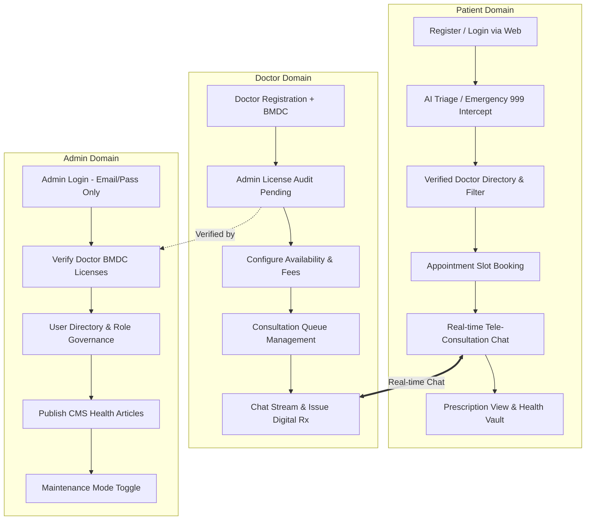

# Software Requirements Specification (SRS) Document

**Purpose:** This document provides a comprehensive description of the intended purpose, functionality, and requirements for the software system **HealthConnect Web**. It serves as a formal communication tool between stakeholders, developers, and evaluators, ensuring a shared understanding of both functional and non-functional expectations.

---

## 1. Introduction

* **Project Name:** HealthConnect Web
* **Prepared by:** Nibir Ahmed (Team Lead), Tanvir Rumon, Nahid Hasan Nibir, Rimon Kumar Das
* **Date:** October 14, 2026
* **Version:** 2.0 (Codebase-Validated Edition)

---

## 2. Overall Description

### 2.1 Product Perspective
HealthConnect Web is a full-stack, responsive web telemedicine and clinical triage platform developed for three distinct operational roles: **Patient**, **Doctor**, and **Administrator**. The system operates across three explicit trust boundaries:
1. **Client Runtime Boundary:** Modern Single-Page Application (SPA) built with **React 19**, bundled via **Vite 8**, routed with **React Router DOM v7**, and styled with **Tailwind CSS v4** and **DaisyUI**, delivering responsive execution across modern desktop and mobile web browsers.
2. **Backend as a Service (BaaS) Boundary:** Cloud backend infrastructure powered by Google Firebase (`healthconnect-web-bd`), providing:
   * **Firebase Authentication:** Role-based identity management (Email/Password & Google OAuth).
   * **Cloud Firestore:** Real-time reactive document streams with forced long-polling (`experimentalForceLongPolling: true`) and client-side reactive store caching (`src/services/db.js`).
   * **Firebase Cloud Storage:** Encrypted binary object hosting for diagnostic scans and prescriptions.
3. **External Intelligence Boundary:** High-throughput Groq Cloud completions API endpoint (`https://api.groq.com/openai/v1/chat/completions`) utilizing `openai/gpt-oss-120b`, grounded by a multi-dataset Clinical Knowledge Base (`src/data/symptom_knowledge_base.json` consolidating Symptom2Disease, SymCat, and localized Banglish/Bengali lexicons) with deterministic local fallback engines.

### 2.2 Stakeholder List
* **Patients (End Users):** Individuals seeking self-triage, physician directory lookup, slot booking, live tele-consultation chat, and digital health records management.
* **Medical Doctors / Practitioners:** Certified clinicians configuring availability hours, conducting tele-consultations, inspecting patient records, and authoring digital prescriptions.
* **System Administrators:** Compliance and operational managers auditing practitioner medical credentials, supervising user roles, publishing health articles, and toggling system maintenance.
* **Regulatory Bodies (e.g., BMDC):** Bangladesh Medical and Dental Council and emergency authorities concerned with verified doctor licenses and immediate emergency escalation (Hotline 999).
* **Development & QA Engineers:** Full-stack team managing repository governance, component testing, Firebase security rules, and AI failover pipelines.

### 2.3 User Stories
* **US-01 (Patient - AI Triage):** As a patient, I want to submit my symptoms in English, Bengali, or Banglish so that I receive immediate clinical triage analysis or instant emergency hotline routing if symptoms are acute.
* **US-02 (Patient - Doctor Discovery):** As a patient, I want to filter verified physicians by medical specialty (Cardiology, Pediatrics, etc.) so that I can schedule a consultation with the appropriate doctor.
* **US-03 (Patient - Health Vault):** As a patient, I want to securely upload diagnostic files (PDF/Images) and print or export my Emergency Medical Card directly from the browser.
* **US-04 (Doctor - Onboarding):** As a doctor, I want to register and submit my BMDC license number for administrator review so that I can be approved and listed publicly in the directory.
* **US-05 (Doctor - Practice Setup):** As a doctor, I want to define my consultation fees and recurring slot schedule so that patients can only reserve slots when I am on duty.
* **US-06 (Doctor - Consultation & Rx):** As a doctor, I want to review my appointment queue, participate in real-time consultation chats, review shared patient records, and generate digital prescriptions.
* **US-07 (Admin - Verification):** As an administrator, I want to review doctor credential submissions and toggle verification status (`isVerified: true`) to prevent uncertified practice.
* **US-08 (Admin - Platform Governance):** As an administrator, I want to publish community health articles through a CMS editor and activate global maintenance mode during system updates.

### 2.4 Product Functions
* **Role-Based Authentication (RBAC):** Multi-role access control for Patient, Doctor, and Admin, enforcing single-factor Email/Password authentication for administrators and permitting Google OAuth for Patients and Doctors.
* **Multilingual AI Clinical Triage & Circuit Breaker:** Natural language symptom intake (Bangla, Banglish, English) evaluated by Groq LLMs, with instant regex interception for critical emergencies (`chest pain`, `stroke`, `বুকে ব্যথা`, `শ্বাসকষ্ট`) triggering hotline `999`.
* **Zero-Downtime Deterministic Fallback:** Heuristic clinical rule engine (`runLocalTriageFallback`) that guarantees symptom evaluation continuity during network timeouts or Groq API rate limits.
* **Verified Physician Directory:** Real-time searchable and categorized registry of verified clinicians displaying specialties, fees, ratings, and experience.
* **Appointment Scheduling & Concurrency Control:** Interactive slot reservation pipeline with collision detection preventing duplicate bookings for the identical doctor and time slot.
* **Real-Time Tele-Consultation Stream:** Bidirectional in-app messaging channel linking patient and doctor with one-tap Health Vault document sharing.
* **Structured Digital Prescription Engine:** Standardized prescription composer capturing drug names, dosages, frequencies, and durations.
* **Digital Health Vault & Emergency Card:** Client-side document vault with file upload validation (PDF, JPEG, PNG <= 10MB) and CSS print-media Emergency Card generation.
* **Administrative Governance & Telemetry:** Verification desk for practitioner auditing, user role management, CMS article editor, and global maintenance toggles.

### 2.5 Constraints
* **Web Architecture:** Built as a modern Single-Page Application using React 19 + Vite 8, styled with Tailwind CSS v4 and DaisyUI, supporting modern evergreen browsers (Chrome, Firefox, Safari, Edge).
* **AI Query Length & Sanitization:** Triage input strings must be sanitized of non-printable control characters and strictly bounded to a maximum length of 1,000 characters.
* **Storage Upload Limits:** Files uploaded to the Health Vault are restricted to MIME types `application/pdf`, `image/jpeg`, and `image/png` with a maximum file size of 10 MB per document.
* **Administrative Security Invariant:** Administrative accounts (`role: 'admin'`) are prohibited from utilizing third-party OAuth (Google Sign-In) and must authenticate exclusively via email/password.
* **Doctor Verification Quarantine:** Doctors with `isVerified: false` are strictly quarantined from public directory queries (`doctors` where `isVerified == true`).
* **High-Latency Network Resilience:** Firestore client configurations must enforce long-polling (`experimentalForceLongPolling: true`) to maintain real-time sync across high-latency cellular networks.
* **Global Maintenance Invariant:** Activation of `maintenanceMode` in `system_config/global` must instantaneously intercept non-administrative routes at the root router layer (`Route.jsx`).

---

## 3. Functional Requirements

| ID | Description | Priority |
| :--- | :--- | :--- |
| **FR-AUTH-01** | The system shall authenticate Patients and Doctors using Email/Password and Google OAuth into `users/{uid}`. | High |
| **FR-AUTH-02** | The system shall restrict Admin authentication strictly to Email/Password credentials, rejecting third-party OAuth. | Critical |
| **FR-AUTH-03** | The system shall enforce a minimum password length of 6 characters and valid email syntax. | High |
| **FR-AUTH-04** | The system shall assign immutable role claims (`role: 'patient'`, `'doctor'`, `'admin'`) upon account initialization. | Critical |
| **FR-TRIAGE-01** | The system shall accept symptom inputs in English, Bengali, or Banglish up to 1,000 characters. | High |
| **FR-TRIAGE-02** | The system shall detect critical emergency keywords (e.g., chest pain, respiratory distress, stroke) and immediately trigger the Emergency Protocol displaying national hotline `999` while suppressing standard flows. | Critical |
| **FR-TRIAGE-03** | The system shall evaluate non-acute symptoms using Groq Cloud LLM (`openai/gpt-oss-120b`) grounded by `symptom_knowledge_base.json` to return severity rating, differential diagnoses, and precautions. | High |
| **FR-TRIAGE-04** | The system shall automatically fail over to `runLocalTriageFallback` with zero downtime upon Groq API error or timeout. | Critical |
| **FR-DOC-01** | The system shall initialize registered doctor profiles under `doctors/{uid}` with `isVerified: false`. | Critical |
| **FR-DOC-02** | The system shall allow doctors to configure bio, specialty, years of experience, fee, and availability time slots (`['09:00 AM', '11:00 AM', '02:00 PM', '04:00 PM']`). | High |
| **FR-DOC-03** | The system shall allow doctors to view appointment requests and update status from `upcoming` to `completed` or `cancelled`. | High |
| **FR-APPT-01** | The system shall query and display only verified doctors (`isVerified == true`) in patient directory searches. | Critical |
| **FR-APPT-02** | The system shall reject duplicate appointment bookings for the identical doctor, date, and time slot at the database transaction layer. | Critical |
| **FR-APPT-03** | The system shall create booking records in `appointments` with initial status `upcoming`, capturing patient UID, doctor UID, date, slot, and fee. | High |
| **FR-CHAT-01** | The system shall synchronize bidirectional messages in real-time under `messages` partitioned by `appointmentId`. | High |
| **FR-CHAT-02** | The system shall allow patients to attach and share Health Vault records directly inside the active tele-consultation channel. | Medium |
| **FR-RX-01** | The system shall provide doctors a prescription builder requiring non-empty fields for medication `name`, `dosage`, `frequency`, and `duration`. | High |
| **FR-RX-02** | The system shall commit finalized prescriptions to `prescriptions/{prescriptionId}` linked to `patientId` and `appointmentId`. | High |
| **FR-VAULT-01** | The system shall allow patients to upload medical records (PDF, JPEG, PNG, max 10MB) to Firebase Storage and track metadata in `health_records/{recordId}`. | High |
| **FR-VAULT-02** | The system shall render and format an Emergency Medical Card with direct browser print / PDF export support (`window.print()`). | Medium |
| **FR-ADM-01** | The system shall provide an admin dashboard to audit doctor credentials and toggle `isVerified: true` or delete fraudulent accounts. | Critical |
| **FR-ADM-02** | The system shall allow administrators to view the user directory and adjust role assignments. | High |
| **FR-ADM-03** | The system shall provide a CMS interface to publish and manage community health articles in `blogs/{blogId}`. | Medium |
| **FR-ADM-04** | The system shall permit administrators to toggle global `maintenanceMode` in `system_config/global`, locking out non-admin navigation. | Critical |
| **FR-NOTIF-01** | The system shall send real-time in-app notifications in `notifications/{notificationId}` for appointment updates and prescription issuance. | Medium |

---

## 4. Non-Functional Requirements

| Category | Requirement |
| :--- | :--- |
| **Performance** | The AI triage response shall be returned to the client within 3.5 seconds under standard broadband/4G conditions; the local fallback engine shall execute in under 150 ms. First Contentful Paint (FCP) of the web app shall be under 1.2s. |
| **Reliability & Availability** | Core consultation and booking workflows shall maintain 99.9% uptime. Dual-engine triage failover shall guarantee zero clinical triage outages during external API downtime. |
| **Security & Privacy** | All communications must use TLS 1.3 encryption. Cloud Firestore security rules must enforce role-based access. Patient health vault records must only be accessible by the owner and the assigned doctor during an active appointment. |
| **Data Integrity** | Appointment slot booking and prescription issuance must execute transactionally to eliminate race conditions and double-booking. |
| **Scalability** | Cloud Firestore database and Firebase Storage must scale automatically to accommodate concurrent active consultation streams without degradation in message delivery times. |
| **Network Resilience** | Client Firestore connections must enable forced long-polling (`experimentalForceLongPolling: true`) to guarantee continuous connectivity across high-latency, spotty cellular networks. |
| **Usability & Accessibility** | The user interface must adapt responsively across mobile, tablet, and desktop viewports, with support for multilingual symptom prompts (Banglish, Bengali, English) and high-contrast emergency banners complying with WCAG 2.1 AA. |
| **Maintainability** | The codebase must adhere to a modular React component architecture, separating UI components, state management (`AuthContext.jsx`), routing (`Route.jsx`), and Firebase services (`src/services/`). |

---

## 5. External Interface Requirements

* **User Interfaces:**
  * Responsive Web SPA built with React 19 + Tailwind CSS v4 + DaisyUI, optimized for Chrome, Safari, Firefox, and Edge.
  * Adaptive design supporting viewports from 360px (mobile) to 1920px+ (desktop monitors).
  * High-contrast Emergency SOS callouts with direct `tel:999` telephony anchors.
* **Hardware Interfaces:**
  * Client device camera and local file system access via standard HTML5 File APIs (`<input type="file" accept=".pdf,image/*">`).
  * Browser printing subsystem for Emergency Card physical print or PDF compilation.
* **Software Interfaces:**
  * **Firebase Authentication Web SDK:** Client-side user auth state observer, JWT token refresh, and Google OAuth popup/redirect handlers.
  * **Cloud Firestore Web SDK:** Reactive snapshot listeners (`onSnapshot`), document queries, and atomic batch writes.
  * **Firebase Cloud Storage Web SDK:** Resumable file upload streams with download URL generation.
* **Communications Interfaces:**
  * **Groq Cloud REST API (`https://api.groq.com/openai/v1/chat/completions`):** HTTPS inference gateway utilizing `openai/gpt-oss-120b`.
  * **Telephony Protocol Interface:** Standard HTML5 `tel:999` anchor protocol launching the host device's native dialer.

---

## 6. Assumptions and Dependencies

* **Assumptions:**
  * End users have access to an internet-connected device running a modern HTML5-compliant web browser.
  * Medical practitioners registering on the platform possess genuine medical licenses issued by the Bangladesh Medical and Dental Council (BMDC).
  * Emergency dispatch telephone service (`999`) is reachable through the user's telecom provider.
  * The administrative root account (`admin@healthconnect.com`) is provisioned during initial setup.
* **Dependencies:**
  * **React 19 & Vite 8 Ecosystem:** Modern web build pipeline, Hot Module Replacement (HMR), and ES modules.
  * **Google Firebase Web Services:** Auth, Firestore NoSQL database, and Cloud Storage bucket availability.
  * **Groq Cloud LLM Platform:** Inference endpoint uptime and API token quota allocations.
  * **Tailwind CSS v4 & DaisyUI:** Utility-first responsive styling and accessible UI components.

---

## 7. Appendices

### Appendix A: Glossary & Acronyms
* **SRS:** Software Requirements Specification
* **RBAC:** Role-Based Access Control
* **BaaS:** Backend as a Service
* **SPA:** Single Page Application
* **LLM:** Large Language Model
* **BMDC:** Bangladesh Medical and Dental Council
* **MIME:** Multipurpose Internet Mail Extensions
* **FCP:** First Contentful Paint

### Appendix B: Firestore Collection Schema Overview
* `users/{uid}`: Base user profile, email, display name, and role (`'patient' | 'doctor' | 'admin'`).
* `doctors/{uid}`: Practitioner metadata, bio, specialty, years of experience, consultation fee, availability array, BMDC number, and verification flag (`isVerified: boolean`).
* `appointments/{appointmentId}`: Booking document linking `patientId`, `doctorId`, `date`, `slot`, `fee`, and `status ('upcoming' | 'completed' | 'cancelled')`.
* `messages/{messageId}`: Real-time chat messages indexed by `appointmentId`, `senderId`, `text`, `timestamp`, and optional `vaultRecordId`.
* `prescriptions/{prescriptionId}`: Clinical prescription details containing array of `{ name, dosage, frequency, duration }` linked to `appointmentId` and `patientId`.
* `health_records/{recordId}`: Health vault entries referencing Firebase Storage download URLs, MIME types, and timestamps.
* `blogs/{blogId}`: Educational content, categories, reading times, and cover images managed by administrators.
* `system_config/global`: Runtime configuration toggles containing `maintenanceMode: boolean` and `emergencyPhone: string`.

### Appendix C: Step-Wise Domain Progression Flowchart

