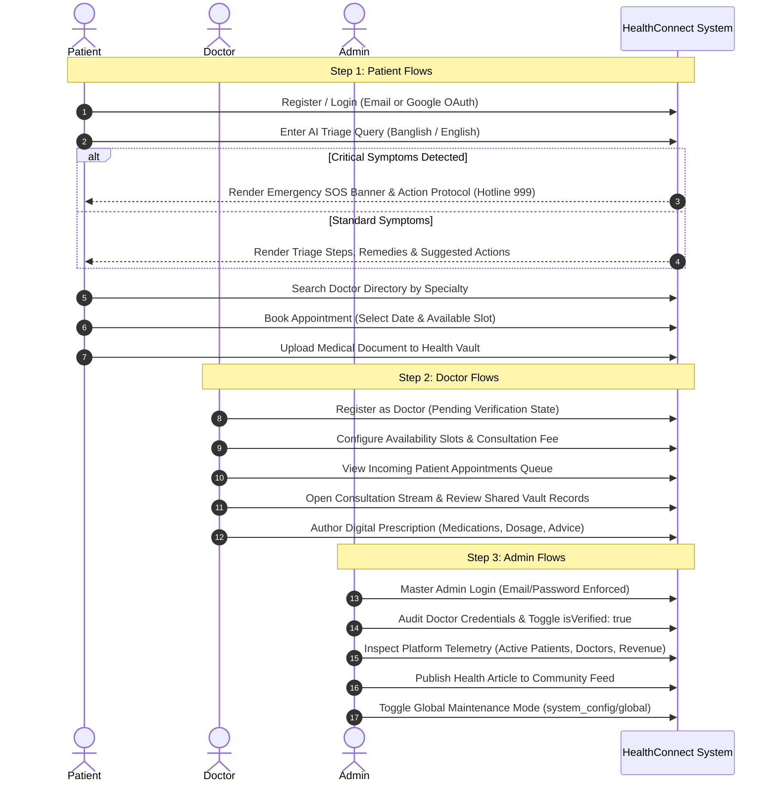

# HealthConnect — Design & Interface Specification (`design.md`)

## 1. Design Tokens & Visual Hierarchy

The HealthConnect visual system emphasizes clinical clarity, accessibility, and high information scent. All components and screens adhere to the centralized design token palette defined in `src/utils/colors.js`.

### 1.1 Color Tokens
| Token Key | Hex / RGBA Value | Semantic Usage |
| :--- | :--- | :--- |
| `primary` | `#2A9D8F` | Core brand color, primary CTA buttons, active tab indicators, headers |
| `primaryLight` | `#3AB8A8` | Interactive hover states, secondary highlights |
| `primaryDark` | `#1E7A6E` | Pressed states, active borders |
| `primaryFaded` | `rgba(42, 157, 143, 0.1)` | Badge backgrounds, selected chip containers, active icon backgrounds |
| `emergency` | `#E63946` | Urgent alert banners, SOS buttons, critical triage highlights, rejection actions |
| `emergencyLight` | `#FF6B6B` | Critical badge accents, pulse indicators |
| `emergencyFaded`| `rgba(230, 57, 70, 0.1)` | Critical triage background, SOS banner fill |
| `background` | `#F8FAFB` | Root application background across all screens |
| `card` | `#FFFFFF` | Elevated container surface |
| `border` | `#E8ECF0` | Structural dividers, input outlines, card borders |
| `divider` | `#F0F2F5` | Subtle horizontal dividers |
| `textPrimary` | `#1A1D26` | Primary headings, clinical labels, title text |
| `textSecondary` | `#6B7280` | Subtitles, timestamps, metadata labels |
| `textLight` | `#9CA3AF` | Placeholder text, disabled labels |
| `textWhite` | `#FFFFFF` | High-contrast text on primary and emergency surfaces |
| `success` | `#10B981` | Verification checkmarks, completed status badges, online presence dot |
| `warning` | `#F59E0B` | Pending verification, upcoming status badges, caution alerts |
| `info` | `#3B82F6` | Informational callouts, article category tags |
| `shadow` | `rgba(0, 0, 0, 0.08)`| Subtle component card elevation |
| `shadowDark` | `rgba(0, 0, 0, 0.15)`| Floating action button elevation, modal drop shadows |

### 1.2 Typography & Scale
- **Display Heading**: 24pt / Bold (Font Weight 700) — Screen titles, dashboard headers.
- **Section Heading**: 18pt / Semi-bold (Font Weight 600) — Card section headings, modal titles.
- **Body Regular**: 14pt / Regular (Font Weight 400) — Messages, descriptions, clinical guidelines.
- **Body Medium**: 14pt / Medium (Font Weight 500) — Button labels, input values, active chips.
- **Caption / Meta**: 12pt / Regular (Font Weight 400) — Timestamps, doctor specialty tags, status indicators.
- **Emergency Alert Text**: 15pt / Bold (Font Weight 700) — Immediate action triage guidance.

### 1.3 Spacing & Layout Grid
- **Base Grid Unit**: 4px.
- **Screen Horizontal Inset**: 16px (Mobile), clamped to 600px centered max-width on Web layout.
- **Card Padding**: 16px vertical, 16px horizontal.
- **Interactive Element Tap Target**: Minimum 48px x 48px per WCAG 2.1 AA specifications.
- **Border Radii**: Cards: 12px; Buttons: 10px; Chips/Badges: 20px (pill style); Inputs: 10px.

---

## 2. Reusable Component Engineering Standards

Components are designed without external bloated UI component libraries, using native React Native primitives styled with exact token references.

### 2.1 `Button` (`src/components/Button.js`)
- **Variants**: `primary` (`colors.primary`), `secondary` (`transparent` with `colors.border` stroke), `danger` (`colors.emergency`), `text` (borderless).
- **States**: `default`, `pressed` (`opacity: 0.85`), `disabled` (`opacity: 0.5`), `loading` (renders `ActivityIndicator` with matching contrast color).
- **Accessibility**: Includes `accessible={true}`, `accessibilityRole="button"`, and dynamic `accessibilityLabel`.

### 2.2 `Input` (`src/components/Input.js`)
- **Structure**: Label text, container with icon slot (left/right via Ionicons), clean text input field, and dedicated error label slot below.
- **Focus Transition**: Border changes from `colors.border` to `colors.primary`. On error state, border switches to `colors.emergency`.
- **Validation**: Enforces native keyboard types (`email-address`, `phone-pad`, `numeric`, `default`).

### 2.3 `Card` (`src/components/Card.js`)
- **Structure**: Background `colors.card`, radius `12px`, border `1px solid colors.border`.
- **Platform Elevations**: Shadow properties for iOS (`shadowColor`, `shadowOffset`, `shadowOpacity`, `shadowRadius`) paired with Android `elevation: 2`.

### 2.4 `Badge` (`src/components/Badge.js`)
- **Status Mapping**:
  - `upcoming`: Background `rgba(245, 158, 11, 0.1)`, Text `colors.warning`.
  - `completed`: Background `rgba(16, 185, 129, 0.1)`, Text `colors.success`.
  - `cancelled`: Background `rgba(230, 57, 70, 0.1)`, Text `colors.emergency`.
  - `verified`: Background `rgba(16, 185, 129, 0.1)`, Text `colors.success`, accompanied by checkmark icon.
  - `pending`: Background `rgba(245, 158, 11, 0.1)`, Text `colors.warning`.

### 2.5 `ChatBubble` (`src/components/ChatBubble.js`)
- **Patient / Self Message**: Aligned right, background `colors.primary`, text `colors.textWhite`, bottom-right radius flattened to `2px`.
- **Doctor / AI / Other Message**: Aligned left, background `colors.card`, text `colors.textPrimary`, border `1px solid colors.border`, bottom-left radius flattened to `2px`.
- **Markdown Parser Integration**: Embedded Markdown renderer parses bold triage instructions, bulleted remedies, and emergency callouts.

---

## 3. Step-Wise Interface & Interaction Specifications

---

### Step 1: Patient User Interface Flows
1. **Authentication Flow (`LoginScreen`, `RegisterScreen`, `RoleSelectionScreen`)**:
   - Clean single-column layout with tabbed or segmented role choice.
   - Input fields validated upon blur and submission: Email (regex matching `^[^\s@]+@[^\s@]+\.[^\s@]+$`), Password (minimum length 6).
2. **AI Triage & Emergency Flow (`EmergencyChatScreen`)**:
   - Interactive prompt chips at screen top for fast one-tap queries (e.g., *"Amar 2 din dhore matha batha r jor"*, *"Chest pain & shortness of breath"*).
   - High-contrast emergency banner pinned to screen top whenever `isEmergency == true` containing direct action button: `Linking.openURL('tel:999')`.
   - Dynamic prompt chips rendered below each AI response to guide actionable follow-ups.
3. **Doctor Discovery & Booking Flow (`DoctorListScreen`, `DoctorProfileScreen`, `AppointmentConfirmScreen`)**:
   - Specialty carousel filter (All, General Physician, Cardiology, Dermatology, Pediatrics, Orthopedics).
   - Doctor card displaying verified badge, experience years, rating, and fee in local currency.
   - Interactive slot grid: disabled slots rendered in `colors.background` with `colors.textLight`; selected slot rendered with `colors.primary` fill and white text.
4. **Tele-Consultation Stream (`DoctorChatScreen`)**:
   - Header displaying physician avatar, name, specialty, and live online indicator.
   - Document attachment button opening `HealthVaultModal` enabling direct one-tap sharing of stored lab reports and prescriptions inside the chat stream.
5. **Emergency Medical Card & Health Records (`MedicalCardScreen`, `HealthRecordsScreen`)**:
   - Visual medical card showing Blood Group in oversized badge, primary emergency contact with direct dial action, and verified allergies.
   - One-tap "Export Emergency Card PDF" invoking `expo-print` and `expo-sharing`.

---

### Step 2: Doctor User Interface Flows
1. **Verification Onboarding (`DoctorProfileSettingsScreen`)**:
   - Banner notification if account status is `isVerified: false`: *"Your credentials are under review by Platform Administration. Your profile will be publicly listed once verified."*
2. **Availability & Fee Schedule (`SetAvailabilityScreen`, `ConsultationSettingsScreen`)**:
   - Toggle matrix for standard consultation hours: `09:00 AM`, `10:00 AM`, `11:00 AM`, `02:00 PM`, `04:00 PM`, `06:00 PM`.
   - Numeric input field for consultation fee with validation rejecting values below 0 or non-numeric characters.
3. **Appointment Management Dashboard (`DoctorHomeScreen`, `DoctorAppointmentsScreen`)**:
   - Tabbed filtering: `Upcoming`, `Completed`, `Cancelled`.
   - One-tap actions: "Join Consultation Chat" (activates live stream) and "Mark Completed" (triggers status update in Firestore).
4. **Digital Prescription Studio (`PrescriptionScreen`)**:
   - Form inputs: Medication Name, Dosage (e.g. `500mg`), Frequency (`1-0-1` or `Every 8 hours`), Duration (`7 days`).
   - Comprehensive Advice / Notes field with keyboard-avoiding container.
   - Submission commits directly to `prescriptions` collection and updates the appointment status.
5. **Patient Vault Inspector (`PatientVaultScreen`)**:
   - Filtered view of patient medical documents and historical reports shared by the patient during consultation.

---

### Step 3: Admin User Interface Flows
1. **Master Control Telemetry (`AdminDashboardScreen`)**:
   - 4-column metric grid displaying real-time counters: Active Patients, Registered Doctors, Pending Doctor Verifications, Total Appointments.
   - Data continuously synchronized via Firestore `onSnapshot` subscriptions.
2. **Doctor Verification Portal (`DoctorVerificationScreen`)**:
   - Filter toggle: `All Doctors`, `Pending Verification`, `Verified Doctors`.
   - Search bar filtering by doctor name or specialty.
   - Action controls: One-tap "Approve & Verify" setting `isVerified: true`, "Edit Credentials" modal for updating BMDC or fee data, and "Reject / Remove" requiring confirmation dialog.
3. **Patient & User Directory (`PatientDirectoryScreen`)**:
   - Master list of platform users with role indicator.
   - Ability to modify user role or inspect profile details.
4. **Community Health Article CMS (`BlogEditorScreen`)**:
   - Inputs for article title, category selection dropdown, estimated read time, author name, and cover image asset selection.
   - Markdown body text editor with live character count.
5. **Global Platform Settings & Emergency Controller (`AdminSettingsScreen`)**:
   - Real-time switch for Maintenance Mode: When toggled, writes to `system_config/global`.
   - Emergency hotline input field (defaults to `999` or custom dispatch number).

---

### Step 4: Cross-Cutting Interface States & Error Handling
1. **Offline & Network Resiliency**:
   - Global status banner displayed when network connectivity is interrupted.
   - Firestore writes persist locally in memory and synchronize automatically upon network resumption.
2. **Empty States**:
   - Tailored vector illustrations and actionable guidance for empty states (e.g., "No Appointments Scheduled", "No Medical Records Found in Vault", "All Doctors Verified").
3. **Destructive Action Confirmations**:
   - Critical operations (cancelling an appointment, deleting a medical record, rejecting a doctor credential) prompt native confirmation dialogs (`Alert.alert`) with explicit destructive buttons.
